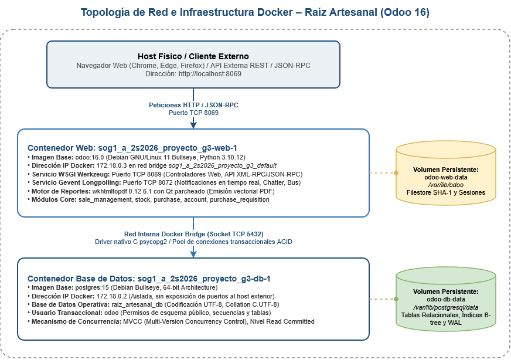
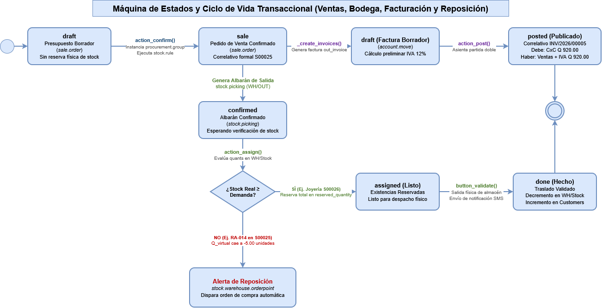
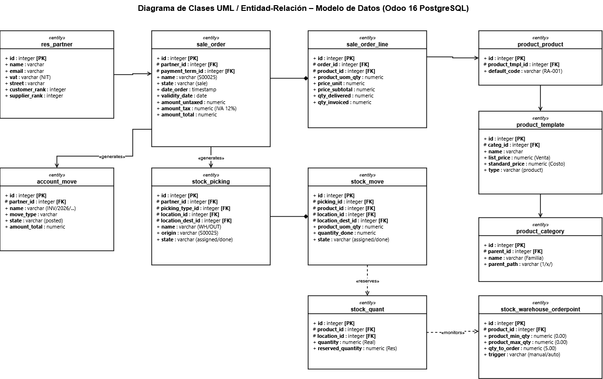

# Manual Técnico – Módulo de Cotizaciones, Ventas e Informes de Inventario (ERP Odoo 16)

---

## 1. Ficha Técnica y Especificaciones de Ingeniería del Sistema

El subsistema de **Cotizaciones a Clientes, Procesos Comerciales de Venta e Informes de Inventario** constituye el núcleo transaccional del ERP **Odoo 16.0 Community Edition**, responsable de gestionar el ciclo de conversión comercial, la reserva de existencias físicas en almacén, la facturación contable oficial y la sincronización de inventario hacia las plataformas de comercio electrónico e inteligencia de negocios (BI).

### 1.1 Dimensionamiento y Requerimientos de Infraestructura (Hardware y Red)

Para garantizar la estabilidad transaccional ACID, la concurrencia de usuarios y el procesamiento de lotes de inventario, se definen los siguientes parámetros de hardware:

| Recurso de Hardware | Requerimiento Mínimo | Requerimiento Recomendado | Función y Justificación Técnica |
| :--- | :--- | :--- | :--- |
| **Procesador (CPU)** | 2 vCPUs x86_64 @ 2.4 GHz | 4 vCPUs x86_64 @ 3.0 GHz+ | Manejo de peticiones HTTP en workers WSGI concurrentes y compilación QWeb. |
| **Memoria RAM** | 4.0 GB LPDDR4 / DDR4 | 8.0 GB DDR4 / ECC | 2.0 GB para buffer pool de PostgreSQL (`shared_buffers`), 4.0 GB para workers de Odoo y 2.0 GB para caché del SO. |
| **Almacenamiento** | 20 GB SSD SATA III | 40 GB+ SSD NVMe M.2 | Soporte de operaciones I/O concurrentes (IOPS > 10,000) requeridas por PostgreSQL en escrituras de WAL (*Write-Ahead Logging*) y persistencia del filestore. |
| **Interfaz de Red** | Ethernet 100 Mbps | Gigabit Ethernet 1000 Mbps | Ancho de banda suficiente para transmisión de reportes PDF vectoriales, catálogos binarios y llamadas JSON-RPC. |
| **Topología de Red** | Red Local / Host-Only | Red Segmentada VLAN / Bridge | Aislamiento de sockets de base de datos mediante red interna virtual Docker. |

### 1.2 Especificaciones de la Pila Tecnológica (Software Stack)

La solución está construida sobre una arquitectura modular desacoplada de código abierto:

| Componente | Tecnología / Versión | Descripción y Función de Ingeniería |
| :--- | :--- | :--- |
| **Sistema Operativo Servidor** | Debian GNU/Linux 11 (Bullseye) | Entorno base en contenedor Linux (Kernel 5.15+), gestión de procesos POSIX. |
| **Motor de Contenedores** | Docker Engine 24.0.7 / Compose v2.21+ | Virtualización ligera a nivel de SO, encapsulamiento en cgroups y namespaces. |
| **Servidor de Aplicaciones** | Odoo 16.0 Community Edition | Framework ERP modular en Python 3.10.12 con servidor WSGI Werkzeug 2.0+. |
| **Gestor de Base de Datos** | PostgreSQL 15.4 (64-bit) | RDBMS relacional transaccional, soporte MVCC, codificación UTF-8, collation `C.UTF-8`. |
| **Motor de Reportes Vectoriales**| `wkhtmltopdf 0.12.6.1` (con Qt parcheado)| Renderizado de plantillas HTML/QWeb a documentos PDF formalmente tipados. |
| **Bibliotecas Python Core** | `psycopg2-binary 2.9`, `jinja2`, `reportlab`, `passlib`, `cryptography`, `Pillow` | Comunicación nativa con PostgreSQL, renderizado de vistas, cálculo criptográfico y procesamiento de imágenes. |

### 1.3 Parámetros de Configuración del Servicio Odoo (`odoo.conf`)

El archivo de configuración maestro del daemon de Odoo (`/etc/odoo/odoo.conf`) gobierna el comportamiento transaccional del servidor:

```ini
[options]
addons_path = /usr/lib/python3/dist-packages/odoo/addons
data_dir = /var/lib/odoo
admin_passwd = Admin2026*
db_host = db
db_port = 5432
db_user = odoo
db_password = odoo_password
db_name = raiz_artesanal_db
db_maxconn = 64
workers = 2
max_cron_threads = 1
limit_memory_hard = 2684354560
limit_memory_soft = 2147483648
limit_time_cpu = 120
limit_time_real = 240
server_wide_modules = base,web
proxy_mode = True
```

* **`db_maxconn = 64`:** Límite máximo de conexiones simultáneas en el pool de PostgreSQL para prevenir agotamiento de file descriptors.
* **`workers = 2`:** Habilita el modo multiproceso WSGI (prefork worker model) para balancear la carga HTTP entre núcleos del procesador.
* **`limit_memory_hard / limit_memory_soft`:** Límites de memoria por worker (2.0 GB soft, 2.5 GB hard) para invocar al recolector de basura antes de saturar el host.
* **`limit_time_cpu / limit_time_real`:** Timeouts estrictos de ejecución para evitar transacciones colgadas o bloqueos (*deadlocks*).

### 1.4 Protocolos, Puertos y Sockets de Comunicación

  
*Diagrama 1: Topología de Red y Arquitectura de Contenedores Docker*


---

## 2. Arquitectura de Software, Desacoplamiento y Seguridad (ACL)

### 2.1 Arquitectura en Tres Capas y Patrón MVC

Odoo 16 implementa una arquitectura desacoplada en tres capas basada en el patrón Modelo-Vista-Controlador:
1. **Capa de Presentación (Frontend):** Vistas declarativas en XML procesadas por el motor **QWeb** y componentes de interfaz reactivos desarrollados sobre el framework JavaScript **OWL (Odoo Web Library)**.
2. **Capa de Lógica de Negocio (Backend):** Servidor en Python que expone modelos derivados de `models.Model`, aplicando reglas de negocio mediante decoradores `@api.depends`, `@api.onchange` y `@api.constrains`.
3. **Capa de Persistencia de Datos:** Gestor relacional PostgreSQL que ejecuta consultas transaccionales con aislamiento de lectura comprometida (*Read Committed*).

### 2.2 Arquitectura del Filestore Desacoplado (Criptografía SHA-1)

A diferencia de los sistemas tradicionales que almacenan imágenes y binarios en columnas de base de datos tipo BLOB, Odoo implementa almacenamiento desacoplado de contenido direccionable:
1. Cuando un usuario adjunta un logotipo, ficha o fotografía de producto, Odoo calcula su hash criptográfico **SHA-1** de 40 dígitos hexadecimales.
2. El archivo binario físico se guarda en la ruta del volumen `/var/lib/odoo/filestore/raiz_artesanal_db/xx/xxyyy...`, donde el subdirectorio `xx` corresponde a los primeros dos caracteres del hash.
3. En la tabla relacional `ir_attachment` se registra exclusivamente una fila con metadatos:
   * `res_model`: Modelo asociado (ej. `product.template`, `sale.order`).
   * `res_id`: Clave primaria del registro vinculado.
   * `checksum`: Valor del hash SHA-1.
   * `store_fname`: Nombre de archivo físico en el filestore.
   * `file_size`: Tamaño exacto en bytes.
4. **Beneficio de ingeniería:** Evita la fragmentación y sobrecrecimiento de la base de datos de PostgreSQL, permitiendo copias de seguridad de datos mucho más ágiles e implementando deduplicación nativa de archivos binarios idénticos.

### 2.3 Matriz de Seguridad y Perfiles de Acceso (ACL)

El control de acceso a nivel de fila y columna está gobernado por el catálogo `ir.model.access` y las reglas dinámicas `ir.rule`:

| Rol / Grupo de Seguridad | Identificador Técnico Odoo | Permisos en `sale_order` | Permisos en `stock_picking` | Permisos en `account_move` |
| :--- | :--- | :---: | :---: | :---: |
| **Responsable de Ventas** | `sales_team.group_sale_manager` | Lectura, Escritura, Creación, Eliminación | Lectura de disponibilidad | Lectura y Creación de Facturas |
| **Vendedor / Operador** | `sales_team.group_sale_salesman` | Lectura, Escritura, Creación propia | Solo lectura de existencias | Ninguno |
| **Administrador de Almacén** | `stock.group_stock_manager` | Solo lectura de pedidos | Lectura, Escritura, Creación, Validación | Solo lectura de valoración |
| **Operador de Bodega** | `stock.group_stock_user` | Solo lectura de pedidos | Lectura y Validación de traslados | Ninguno |
| **Administrador General** | `base.group_system` | Control Total Irrestricto (Superusuario) | Control Total Irrestricto | Control Total Irrestricto |

---

## 3. Diccionario de Datos y Mapeo Relacional de Tablas (PostgreSQL)

A continuación se detalla la estructura física y relacional de los modelos de base de datos que sustentan el ciclo de ventas, la reserva de almacén, la facturación y la cadena de suministros en Odoo 16:

### 3.1 Diagrama Entidad-Relación Conceptual

  
*Diagrama 2: Modelo Entidad-Relación de Base de Datos PostgreSQL*


### 3.2 Especificación Detallada de Tablas

#### Tabla: `sale_order` (Encabezado de Cotizaciones y Pedidos de Venta)
| Campo | Tipo PostgreSQL | Nulo | Restricciones / Reglas | Descripción Técnica |
| :--- | :--- | :---: | :--- | :--- |
| `id` | `INTEGER` | NO | `PRIMARY KEY`, Secuencia autoincremental | Identificador único de la orden comercial. |
| `name` | `VARCHAR(64)` | NO | `UNIQUE`, `NOT NULL`, Índice B-tree | Correlativo formal de venta (ej. `S00025`, `S00026`). |
| `partner_id` | `INTEGER` | NO | `FOREIGN KEY (res_partner.id) ON DELETE RESTRICT` | Cliente comercial asignado. |
| `state` | `VARCHAR(32)` | NO | `CHECK (state IN ('draft','sent','sale','done','cancel'))` | Estado transaccional en la máquina de estados. |
| `date_order` | `TIMESTAMP` | NO | `DEFAULT NOW()` | Fecha y hora formal de confirmación. |
| `validity_date` | `DATE` | SÍ | `DEFAULT NULL` | Fecha de vencimiento comercial de la oferta cotizada. |
| `payment_term_id`| `INTEGER` | SÍ | `FOREIGN KEY (account_payment_term.id) ON DELETE SET NULL` | Términos y plazos de crédito pactados. |
| `amount_untaxed` | `NUMERIC(16,2)` | NO | `DEFAULT 0.00` | Base imponible neta sin impuestos en Quetzales. |
| `amount_tax` | `NUMERIC(16,2)` | NO | `DEFAULT 0.00` | Importe fiscal retenido (12% IVA según legislación SAT). |
| `amount_total` | `NUMERIC(16,2)` | NO | `DEFAULT 0.00`, `amount_untaxed + amount_tax` | Importe total bruto facturado al cliente. |

#### Tabla: `sale_order_line` (Partidas y Líneas de Cotización)
| Campo | Tipo PostgreSQL | Nulo | Restricciones / Reglas | Descripción Técnica |
| :--- | :--- | :---: | :--- | :--- |
| `id` | `INTEGER` | NO | `PRIMARY KEY`, Secuencia autoincremental | Identificador único de la línea de producto. |
| `order_id` | `INTEGER` | NO | `FOREIGN KEY (sale_order.id) ON DELETE CASCADE`, Índice B-tree | Clave foránea al maestro de la orden. |
| `product_id` | `INTEGER` | NO | `FOREIGN KEY (product_product.id) ON DELETE RESTRICT` | Artículo comercial cotizado. |
| `product_uom_qty`| `NUMERIC(16,2)` | NO | `NOT NULL`, `CHECK (product_uom_qty >= 0)` | Cantidad solicitada por el cliente. |
| `price_unit` | `NUMERIC(16,2)` | NO | `NOT NULL` | Precio unitario cotizado al cliente. |
| `price_subtotal` | `NUMERIC(16,2)` | NO | Calculado (`product_uom_qty * price_unit`) | Subtotal neto antes de impuestos. |
| `qty_delivered` | `NUMERIC(16,2)` | NO | `DEFAULT 0.00` | Cantidad efectivamente despachada y validada en almacén. |
| `qty_invoiced` | `NUMERIC(16,2)` | NO | `DEFAULT 0.00` | Cantidad liquidada en facturas contables. |

#### Tabla: `stock_picking` (Albaranes y Traslados de Almacén)
| Campo | Tipo PostgreSQL | Nulo | Restricciones / Reglas | Descripción Técnica |
| :--- | :--- | :---: | :--- | :--- |
| `id` | `INTEGER` | NO | `PRIMARY KEY`, Secuencia autoincremental | Clave primaria de la operación de traslado. |
| `name` | `VARCHAR(64)` | NO | `UNIQUE`, `NOT NULL`, Índice B-tree | Correlativo secuencial (ej. `WH/OUT/00014`, `WH/IN/00010`). |
| `origin` | `VARCHAR(64)` | SÍ | Índice B-tree | Documento comercial de origen (ej. `S00025`, `P00027`). |
| `picking_type_id`| `INTEGER` | NO | `FOREIGN KEY (stock_picking_type.id) ON DELETE RESTRICT` | Tipo de operación: 1=Recepción, 2=Interno, 3=Salida. |
| `location_id` | `INTEGER` | NO | `FOREIGN KEY (stock_location.id) ON DELETE RESTRICT` | Ubicación física de origen (ej. 8=`WH/Stock`, 4=`Suppliers`). |
| `location_dest_id`| `INTEGER` | NO | `FOREIGN KEY (stock_location.id) ON DELETE RESTRICT` | Ubicación física de destino (ej. 5=`Customers`, 8=`WH/Stock`).|
| `state` | `VARCHAR(32)` | NO | `CHECK (state IN ('draft','waiting','confirmed','assigned','done','cancel'))`| Estado de la transferencia física. |

#### Tabla: `stock_quant` (Existencias Físicas en Tiempo Real)
| Campo | Tipo PostgreSQL | Nulo | Restricciones / Reglas | Descripción Técnica |
| :--- | :--- | :---: | :--- | :--- |
| `id` | `INTEGER` | NO | `PRIMARY KEY`, Secuencia autoincremental | Clave primaria del quant físico. |
| `product_id` | `INTEGER` | NO | `FOREIGN KEY (product_product.id) ON DELETE CASCADE`, Índice | Variante de producto registrada en stock. |
| `location_id` | `INTEGER` | NO | `FOREIGN KEY (stock_location.id) ON DELETE CASCADE`, Índice | Ubicación física de almacenamiento. |
| `quantity` | `NUMERIC(16,2)` | NO | `DEFAULT 0.00` | Saldo físico exacto existente en la ubicación. |
| `reserved_quantity`| `NUMERIC(16,2)`| NO | `DEFAULT 0.00`, `CHECK (reserved_quantity <= quantity)` | Unidades bloqueadas lógicamente por órdenes confirmadas. |

#### Tabla: `account_move` y `account_move_line` (Asientos Contables y Facturación)
* **`account_move`:** Encabezado del documento contable. Campos críticos: `id`, `name` (ej. `INV/2026/00005`), `move_type` (`'out_invoice'` para facturas de clientes, `'in_invoice'` para compras), `state` (`'draft'`, `'posted'`), `partner_id`, `amount_untaxed`, `amount_tax`, `amount_total`.
* **`account_move_line`:** Partidas contables de partida doble. Campos críticos: `id`, `move_id`, `account_id` (Plan contable), `name`, `debit` (Monto al Debe), `credit` (Monto al Haber), `tax_ids` (Vínculo al impuesto fiscal). Regla estricta de integridad: $\sum \text{debit} = \sum \text{credit}$.

---

## 4. Lógica de Negocio, Máquinas de Estados y Métodos del ORM

### 4.1 Máquina de Estados y Transiciones de `sale.order`

  
*Diagrama 3: Máquina de Estados y Ciclo Transaccional de Ventas*


1. **Método `action_confirm()`:**
   * Valida que las líneas de pedido tengan cantidades mayores a cero y precios asignados.
   * Invoca a `procurement.group` para orquestar la cadena de suministro.
   * Dispara el resolvedor de reglas de abastecimiento (`stock.rule`) que determina la ruta de almacenamiento (`WH/Stock` -> `Partner Locations/Customers`).
   * Crea automáticamente la orden de despacho en `stock.picking` con `picking_type_id = 3` (Salida) en estado `confirmed`.
   * Invoca inmediatamente el método de reserva de existencias `action_assign()`.

2. **Lógica de Reserva de Existencias (`action_assign()`):**
   * El sistema recorre las líneas de producto en `stock.move` y consulta `stock_quant` en la ubicación de salida.
   * Si $\text{stock\_quant.quantity} - \text{stock\_quant.reserved\_quantity} \ge \text{product\_uom\_qty}$:
     * Incrementa `stock_quant.reserved_quantity` con la cantidad solicitada.
     * La línea de despacho cambia a estado `assigned` (Listo).
   * Si las existencias físicas son menores a lo demandado (como sucedió en el artículo `RA-014` del pedido `S00025`, donde se cotizaron 10 unidades habiendo solo 5 en bodega):
     * Reserva el total físico disponible (5 unidades).
     * El pronóstico virtual de inventario cae a saldo negativo (`-5.00`), alertando automáticamente al motor de reposición.

3. **Validación Física de Salida (`button_validate()`):**
   * Al ejecutar la validación física en bodega:
     * Transfiere las unidades decrementando `stock_quant.quantity` en `WH/Stock` e incrementando en `Customers`.
     * Reduce `stock_quant.reserved_quantity` a cero, liberando el bloqueo lógico.
     * Genera registros en `stock.valuation.layer` para asentar la salida de valor monetario del almacén al costo estándar.
     * Cambia el estado del albarán a `done` (Hecho).
     * Dispara los hooks del módulo `stock_sms` para notificar al cliente vía SMS.

4. **Facturación y Asentamiento de Partida Doble (`action_post()`):**
   * Invoca `_create_invoices()` creando un registro en `account.move` con `move_type = 'out_invoice'`.
   * Al presionar *Confirmar*, el método `action_post()` valida el asiento contable en partida doble:
     * **Cargo (Debe):** Cuenta por Cobrar Clientes (`account_type = asset_receivable`) por el importe total bruto (Q 920.00).
     * **Abono (Haber):** Cuenta de Ingresos por Venta (`account_type = income`) por la base imponible neta (Q 821.43).
     * **Abono (Haber):** Cuenta de IVA por Pagar (`account_type = liability_current`) por el 12% impositivo retenido (Q 98.57).

### 4.2 Modelado Matemático de Existencias y Motor de Reposición

Odoo evalúa en tiempo real tres magnitudes fundamentales para cada producto $i$:

$$\text{Stock Real Físico: } Q_{\text{real}, i} = \sum_{k \in \text{Ubicaciones Internas}} \text{stock\_quant.quantity}_{i, k}$$

$$\text{Stock Disponible para Venta: } Q_{\text{disp}, i} = Q_{\text{real}, i} - \sum \text{stock\_quant.reserved\_quantity}_i$$

$$\text{Stock Virtual Pronosticado: } Q_{\text{virtual}, i} = Q_{\text{real}, i} + \sum Q_{\text{compras entrantes}, i} - \sum Q_{\text{ventas salientes}, i}$$

#### Regla de Reposición Automática (`stock.warehouse.orderpoint`):
El motor evalúa periódicamente la condición:

$$\text{Si } Q_{\text{virtual}, i} < \text{Stock Mínimo}_i \implies \text{Cantidad a Reabastecer} = \text{Stock Máximo}_i - Q_{\text{virtual}, i}$$

En el caso real evaluado con el artículo `[RA-014] Set de 6 Individuales Tejidos a Mano`:
* $Q_{\text{real}} = 5.00$
* $Q_{\text{saliente demandado}} = 10.00$ (comprometido en S00025)
* $Q_{\text{virtual}} = 5.00 - 10.00 = -5.00$ unidades.
* Condición evaluada: $-5.00 < 0.00$ (Stock crítico alertado).
* Cantidad calculada a solicitar: $0.00 - (-5.00) = 5.00$ unidades.
* Al ejecutarse la acción `_procure_orderpoint_confirm()`, el sistema busca en la ficha técnica el proveedor asignado (`Cooperativa Tejedoras San Juan`) y redacta automáticamente la orden de compra `P00028`.

### 4.3 Jerarquía de Categorías de Producto y Rutas `parent_path` (Soporte BI)

Para habilitar consultas analíticas agregadas de alta velocidad en herramientas de Business Intelligence (Power BI, Metabase), la estructura de `product_category` se gestiona mediante el algoritmo de árbol materializado `parent_path`:

```sql
UPDATE product_category SET parent_path = '1/' || id || '/' WHERE parent_id = 1;
```

Esta indexación permite que una consulta sobre la categoría padre `All` (id=1) resuelva en tiempo logarítmico $O(\log n)$ todos los productos descendientes de las 6 familias artesanales sin necesidad de recursión SQL compleja.

---

## 5. Procedimiento Técnico Paso a Paso con Validación Visual y Modelos Intervenidos

A continuación se documenta la ejecución técnica del sistema integrando paso a paso las capturas de pantalla con los modelos, tablas y métodos ejecutados en Odoo:

### 5.1 Configuración Base del Módulo de Ventas y Cartera de Clientes

#### Paso 1: Inicialización del Módulo de Ventas
Al acceder al menú principal, el controlador web invoca la acción `sale.action_quotations_with_onboarding`, ejecutando una consulta `SELECT` sobre `sale_order` para renderizar el tablero kanban/tree mediante componentes JavaScript OWL.

  
*Figura 1: Vista general del tablero principal del módulo de Ventas con el listado de presupuestos.*

#### Paso 2: Configuración de Parámetros Comerciales
En **Ventas -> Configuración -> Ajustes**, Odoo modifica el modelo transitorio `res.config.settings`. Se activan los flags booleanos para aprobación de presupuestos y gestión de direcciones de facturación y despacho.

  
*Figura 2: Opciones de configuración comercial activas en la sección Presupuestos & pedidos.*

#### Paso 3: Verificación de Parámetros de Facturación
Se validan las directivas de emisión de facturas (`sale.default_invoice_policy = 'delivery'`), asegurando que las facturas a consumidores finales se emitan únicamente tras la confirmación física del despacho.

  
*Figura 3: Parámetros de facturación de clientes y opciones de envío por defecto.*

#### Paso 4: Auditoría del Directorio de Clientes (`res_partner`)
El sistema consulta la tabla `res_partner` filtrando por `customer_rank > 0`. Se comprueba la existencia de entidades jurídicas corporativas como **Hotel Casa Santo Domingo** y consumidores particulares como **María Fernanda Morales**.

  
*Figura 4: Directorio de clientes importados en la cartera comercial de Odoo.*

---

### 5.2 Ciclo Transaccional Corporativo (Orden S00025 y Reserva en Bodega)

#### Paso 5: Formulario de Nueva Cotización (`sale.order` en estado `draft`)
Al presionar el botón *Nuevo*, el controlador invoca `sale.order.default_get()`, instanciando un registro en memoria con moneda predeterminada en Quetzales (GTQ).

  
*Figura 5: Formulario en blanco para la captura de una nueva cotización comercial.*

#### Paso 6: Asignación de Cliente Corporativo y Términos Comerciales
Se define `partner_id = Hotel Casa Santo Domingo` y se vincula la clave foránea `payment_term_id` correspondiente a `15 días`. Se establece el vencimiento de la oferta a 30 días calendario.

  
*Figura 6: Cabecera con datos del cliente corporativo, condiciones de pago a 15 días y vencimiento.*

#### Paso 7: Inserción de Partidas en `sale_order_line`
Se registran las tres líneas textiles cotizadas:
* `RA-010` (15 u. x Q 220.00 = Q 3,300.00).
* `RA-011` (8 u. x Q 340.00 = Q 2,720.00).
* `RA-014` (10 u. x Q 360.00 = Q 3,600.00).
El método `_compute_amounts()` calcula en tiempo real la base imponible neta (Q 8,589.29), el IVA fiscal del 12% (Q 1,030.71) y el monto total de **Q 9,620.00**.

  
*Figura 7: Detalle de productos textiles cotizados con cálculo de subtotales, IVA y total Q 9,620.00.*

#### Paso 8: Persistencia del Pedido y Asignación de Correlativo (`S00025`)
Al presionar *Guardar*, la secuencia de Odoo consume el siguiente valor numérico disponible, registrando formalmente el pedido `S00025` en la base de datos de PostgreSQL.

  
*Figura 8: Cotización guardada y confirmada en el sistema con su correlativo oficial S00025.*

#### Paso 9: Generación del Reporte QWeb Vectorial en PDF
Al solicitar la impresión, el motor `wkhtmltopdf` compila la plantilla `sale.report_saleorder`, renderizando un documento PDF con los membretes corporativos, tabla de desglose impositivo y condiciones de pago.

  
*Figura 9: Vista del documento oficial de cotización en formato PDF para presentación al cliente.*

#### Paso 10: Confirmación de Venta y Reserva de Stock (`WH/OUT/00014`)
La ejecución de `action_confirm()` genera el albarán de entrega `WH/OUT/00014`. El método `action_assign()` bloquea las unidades disponibles en `stock_quant`, dejando el albarán en estado `assigned` (Listo).

  
*Figura 10: Orden de entrega generada (WH/OUT/00014) con existencias reservadas en el almacén en estado Listo.*

---

### 5.3 Ciclo Minorista, Despacho Físico y Facturación Contable (Orden S00026)

#### Paso 11: Registro de Cotización Directa a Consumidor Final
Se crea una cotización para `María Fernanda Morales` con `payment_term_id = Pago inmediato`, seleccionando piezas de joyería de jade y plata: `RA-022` (1 u. a Q 490.00) y `RA-023` (1 u. a Q 430.00), totalizando **Q 920.00**.

  
*Figura 11: Formulario de cotización directa de piezas de joyería artesanal a María Fernanda Morales.*

#### Paso 12: Confirmación Comercial del Pedido `S00026`
Al confirmar el presupuesto, el estado pasa a `sale` y el campo relacional `picking_ids` vincula automáticamente la nueva orden de entrega `WH/OUT/00015`.

  
*Figura 12: Pedido de venta S00026 confirmado con botón inteligente de entrega habilitado.*

#### Paso 13: Preparación del Albarán de Despacho `WH/OUT/00015`
Se abre la orden de salida en estado `assigned`. La columna `Demanda` muestra 1.00 para cada artículo, con stock físico reservado en bodega central.

  
*Figura 13: Orden de salida WH/OUT/00015 en estado Listo para validación de despacho.*

#### Paso 14: Validación Física del Traslado (`button_validate()`)
Se presionan los botones *Establecer cantidades* y *Validar*. La transacción pasa a estado `done`, descontando las existencias en `stock_quant` y registrando el movimiento en `stock_move_line`.

  
*Figura 14: Traslado de almacén validado en estado Hecho con confirmación de entrega.*

#### Paso 15: Asistente Modal de Facturación
Desde el pedido `S00026`, se abre el asistente modal `sale.advance.payment.inv`. Se selecciona la opción de factura regular por las cantidades entregadas.

  
*Figura 15: Cuadro de diálogo para generación de factura regular del pedido.*

#### Paso 16: Asentamiento Contable Oficial (`INV/2026/00005`)
Al presionar *Confirmar* en el borrador de factura, el método `action_post()` genera la secuencia oficial `INV/2026/00005`, asentando los débitos y créditos en el libro diario de clientes.

  
*Figura 16: Factura de venta oficial confirmada en estado Publicado por valor de Q 920.00.*

---

### 5.4 Control de Inventario, Valoración y Órdenes Pendientes de Proveedores

#### Paso 17: Navegación al Tablero de Informes de Almacén
Desde el módulo de Inventario, se ejecuta la acción `stock.action_product_stock_view`, cargando la vista pivote y de lista con el inventario valorizado.

  
*Figura 17: Acceso al reporte general de existencias desde el menú del módulo de Inventario.*

#### Paso 18: Reporte de Existencias Físicas y Valoración Total
La consulta SQL calcula dinámicamente el valor en Quetzales de las existencias físicas para los 30 productos:
$$\text{Valor Total} = \sum (\text{stock\_quant.quantity} \times \text{product\_template.standard\_price}) = \mathbf{Q\ 95,015.00}$$

  
*Figura 18: Listado general de existencias físicas de los 30 productos con valoración total de Q 95,015.00.*

#### Paso 19: Agrupación Multidimensional por Categoría de Producto
Se aplica el filtro `group_by = categ_id`. El sistema agrupa las existencias en las 6 familias artesanales oficiales configuradas con `parent_path`.

  
*Figura 19: Existencias consolidadas y valorizadas agrupadas por las 6 categorías de producto artesanales.*

#### Paso 20: Detección de Órdenes Pendientes de Proveedores (`P00027`)
En **Compra -> Pedidos -> Pedidos de compra**, se audita la orden `P00027` emitida a `Taller Cerámica Maya Antigua` por Q 1,750.00 en estado `purchase`, confirmando que los artículos están en tránsito hacia la bodega.

  
*Figura 20: Reporte de compras con la orden P00027 pendiente de recepción en almacén.*

#### Paso 21: Albarán de Entrada en Tránsito (`WH/IN/00010`)
En **Inventario -> Recepciones**, se verifica el albarán `WH/IN/00010` vinculado a `P00027`, en estado `assigned` listo para la recepción física por el encargado de almacén.

  
*Figura 21: Vista de traslados de entrada pendientes (WH/IN/00010) en el módulo de Inventario.*

---

### 5.5 Reglas de Reposición Automática y Auditoría de Movimientos

#### Paso 22: Tablero de Reposición y Detección de Déficit
En **Inventario -> Operaciones -> Reposición**, el sistema evalúa las existencias del producto `[RA-014] Set de 6 Individuales`. Al tener 5 unidades físicas y 10 comprometidas en la orden `S00025`, el pronóstico cae a **`-5.00`**, activando la alerta de abastecimiento crítico.

  
*Figura 22: Tablero de reposición con alerta de stock de RA-014 Set de individuales.*

#### Paso 23: Disparo de Reorden Automática (`P00028`)
Al accionar *Pedir de una*, el método `_procure_orderpoint_confirm()` localiza el costo y proveedor de `RA-014` y genera reactivamente la orden de compra `P00028` en el módulo de Compras.

  
*Figura 23: Generación automática de la orden de reposición P00028 tras presionar Pedir de una.*

#### Paso 24: Auditoría y Trazabilidad Histórica de Almacén
En **Inventario -> Informes -> Historial de movimientos**, se filtra por los productos de joyería `RA-022` y `RA-023`. Se certifica la trazabilidad completa de la Fase 2:
1. Ajuste inicial de inventario (+3 y +2 u. por Norma).
2. Recepción de compra a proveedores `WH/IN/00008` (+10 y +10 u. por Javier).
3. Salida por venta minorista `WH/OUT/00015` (-1 y -1 u. por Eduardo).

  
*Figura 24: Historial de movimientos auditando la trazabilidad de entrada por compras y salida por ventas.*

---

## 6. Evidencias de Auditoría SQL Directa en PostgreSQL

Se presentan las consultas SQL ejecutadas directamente en el motor relacional de PostgreSQL:

### 6.1 Auditoría de Pedidos de Venta, Albaranes y Facturación
```sql
SELECT 
    s.name AS pedido,
    s.state AS estado_venta,
    s.amount_total AS total_q,
    p.name AS albaran,
    p.state AS estado_albaran,
    m.name AS factura,
    m.state AS estado_factura
FROM sale_order s
LEFT JOIN stock_picking p ON p.origin = s.name
LEFT JOIN sale_order_line sol ON sol.order_id = s.id
LEFT JOIN sale_order_line_invoice_rel rel ON rel.order_line_id = sol.id
LEFT JOIN account_move_line aml ON aml.id = rel.invoice_line_id
LEFT JOIN account_move m ON m.id = aml.move_id
WHERE s.name IN ('S00025', 'S00026')
GROUP BY s.name, s.state, s.amount_total, p.name, p.state, m.name, m.state;
```
* **Salida de la consulta:**
  * `S00025` | `sale` | `Q 9,620.00` | `WH/OUT/00014` | `assigned` | Sin facturar (Crédito comercial a 15 días).
  * `S00026` | `sale` | `Q 920.00` | `WH/OUT/00015` | `done` | `INV/2026/00005` | `posted`.

### 6.2 Auditoría de Órdenes de Compra y Recepciones en Tránsito
```sql
SELECT 
    po.name AS orden_compra, 
    po.state AS estado_po, 
    po.amount_total AS total_q, 
    sp.name AS recepcion, 
    sp.state AS estado_recepcion
FROM purchase_order po
LEFT JOIN stock_picking sp ON sp.origin = po.name
WHERE po.name IN ('P00027', 'P00028');
```
* **Salida de la consulta:**
  * `P00027` | `purchase` | `Q 1,750.00` | `WH/IN/00010` | `assigned` (Mercancía en tránsito pendiente de ingreso).
  * `P00028` | `draft` | Generada automáticamente por el motor de reposición ante el déficit de `RA-014`.

### 6.3 Auditoría de la Partida Doble en el Asiento Contable `INV/2026/00005`
```sql
SELECT 
    aml.name AS concepto,
    acc.code AS codigo_cuenta,
    acc.name AS nombre_cuenta,
    aml.debit AS debe,
    aml.credit AS haber
FROM account_move_line aml
JOIN account_move am ON am.id = aml.move_id
JOIN account_account acc ON acc.id = aml.account_id
WHERE am.name = 'INV/2026/00005';
```
* **Salida de la consulta:**
  * Cobro Cliente María Fernanda | `110200` | Cuentas por Cobrar Clientes | Debe: `Q 920.00` | Haber: `Q 0.00`
  * [RA-022] Dije Jade Verde | `400000` | Ingresos por Ventas | Debe: `Q 0.00` | Haber: `Q 437.50`
  * [RA-023] Aretes Jade Lila | `400000` | Ingresos por Ventas | Debe: `Q 0.00` | Haber: `Q 383.93`
  * IVA Débito Fiscal (12%) | `210400` | Impuestos por Pagar (SAT) | Debe: `Q 0.00` | Haber: `Q 98.57`
  * **Balance:** $\sum \text{Debe} = \mathbf{Q\ 920.00} \equiv \sum \text{Haber} = \mathbf{Q\ 920.00}$ (Partida Cuadrada Exacta).

---

## 7. Procedimientos de Operación, Respaldo, Restauración y Troubleshooting

### 7.1 Protocolo de Copia de Seguridad Integral (Base de Datos + Filestore)

Para generar un respaldo consistente del sistema sin detener la operación de los contenedores:

```bash
# 1. Extracción de dump binario comprimido de PostgreSQL
docker exec -t sog1_a_2s2026_proyecto_g3-db-1 pg_dump -U odoo -F c -b -v -f /tmp/backup_raiz_artesanal.dump raiz_artesanal_db
docker cp sog1_a_2s2026_proyecto_g3-db-1:/tmp/backup_raiz_artesanal.dump ./backup_raiz_artesanal.dump

# 2. Empaquetado comprimido del filestore de imágenes
docker run --rm --volumes-from sog1_a_2s2026_proyecto_g3-web-1 -v $(pwd):/backup debian:bullseye tar -czf /backup/filestore_backup.tar.gz /var/lib/odoo/filestore/raiz_artesanal_db
```

### 7.2 Protocolo de Restauración y Puesta en Marcha

```bash
# 1. Copia del dump y recreación de la base de datos
docker cp ./backup_raiz_artesanal.dump sog1_a_2s2026_proyecto_g3-db-1:/tmp/backup.dump
docker exec -t sog1_a_2s2026_proyecto_g3-db-1 dropdb -U odoo raiz_artesanal_db
docker exec -t sog1_a_2s2026_proyecto_g3-db-1 createdb -U odoo raiz_artesanal_db
docker exec -t sog1_a_2s2026_proyecto_g3-db-1 pg_restore -U odoo -d raiz_artesanal_db -v /tmp/backup.dump

# 2. Restauración de los archivos del filestore en el volumen persistente
docker run --rm --volumes-from sog1_a_2s2026_proyecto_g3-web-1 -v $(pwd):/backup debian:bullseye tar -xzf /backup/filestore_backup.tar.gz -C /
```

### 7.3 Análisis de Causa Raíz (RCA) y Solución al Fallo de Activos Web (Assets HTTP 500)

* **Descripción del Fallo:** Al restaurar una base de datos entre diferentes entornos Docker, el navegador web arrojaba error de servidor interno HTTP 500 y no cargaba los estilos CSS ni los scripts de JavaScript.
* **Causa Raíz:** En Odoo, los paquetes web minificados se registran en `ir_attachment` apuntando a URLs relativas (`/web/assets/%`). Al migrar la base de datos sin regenerar los activos, el servidor Werkzeug WSGI intentaba leer archivos locales inexistentes en disco, disparando la excepción `FileNotFoundError`.
* **Solución de Ingeniería Aplicada:** Purgar los registros huérfanos de la tabla de metadatos y reiniciar el contenedor para obligar a Odoo a recompilar todos los paquetes CSS/JS desde los fuentes XML:

```bash
docker exec sog1_a_2s2026_proyecto_g3-db-1 psql -U odoo -d raiz_artesanal_db -c "DELETE FROM ir_attachment WHERE url LIKE '/web/assets/%';"
docker restart sog1_a_2s2026_proyecto_g3-web-1
```

### 7.4 Guía de Diagnóstico Técnico (Troubleshooting)

| Síntoma de Falla | Causa Probable | Comando / Acción Correctiva |
| :--- | :--- | :--- |
| **Error: `connection to server on socket failed`** | Contenedor de base de datos detenido o no responde. | `docker restart sog1_a_2s2026_proyecto_g3-db-1` y verificar logs con `docker logs sog1_a_2s2026_proyecto_g3-db-1`. |
| **Bloqueo en confirmación de orden (Lock Timeout)** | Transacción concurrente reteniendo un bloqueo de fila en `stock_quant`. | Ejecutar en PostgreSQL: `SELECT pg_terminate_backend(pid) FROM pg_stat_activity WHERE state = 'idle in transaction' AND wait_event_type = 'Lock';` |
| **Imagen de producto no visible (icono roto)** | Desincronización del hash SHA-1 en el filestore. | Verificar permisos del volumen persistente (`chown -R odoo:odoo /var/lib/odoo/filestore`) o reimportar la imagen binaria desde la interfaz. |
| **Memoria agotada en el servidor (OOM Killer)** | Fuga de memoria por exceso de consultas sin paginar. | Reducir el valor de `limit_memory_soft` en `odoo.conf` y ajustar `workers` al número exacto de núcleos físicos disponibles. |
