# Manual de Usuario - Cotizaciones a Clientes e Informes de Inventario (ERP Odoo)

---

## 1. Introducción y Propósito del Manual

El presente Manual de Usuario tiene como propósito guiar al personal administrativo y operativo de **Raíz Artesanal** en el uso cotidiano del sistema ERP Odoo 16 para la gestión del ciclo comercial de ventas y el control del almacén.

---

## 2. Requisitos Previos para el Usuario

Para operar las funciones comerciales e informes del sistema, el usuario debe contar con:
* Un navegador web moderno (Google Chrome, Mozilla Firefox o Microsoft Edge).
* Dirección web de acceso al sistema ERP: `http://localhost:8069/web/login`.
* Credenciales de acceso autorizadas con perfil de **Ventas** e **Inventario**.
* Conexión activa a la red local del servidor donde se encuentra desplegado el contenedor de Odoo.

---

## 3. Acceso y Configuración Inicial del Módulo de Ventas

### 3.1 Ingreso al Módulo de Ventas
Para comenzar a gestionar cotizaciones:
1. Inicie sesión en Odoo ingresando sus credenciales de usuario.
2. Haga clic en el menú principal de aplicaciones (icono de cuadrícula en la esquina superior izquierda) y seleccione **Ventas**.
3. Se desplegará el tablero principal donde se listan todas las cotizaciones y pedidos registrados en el sistema.

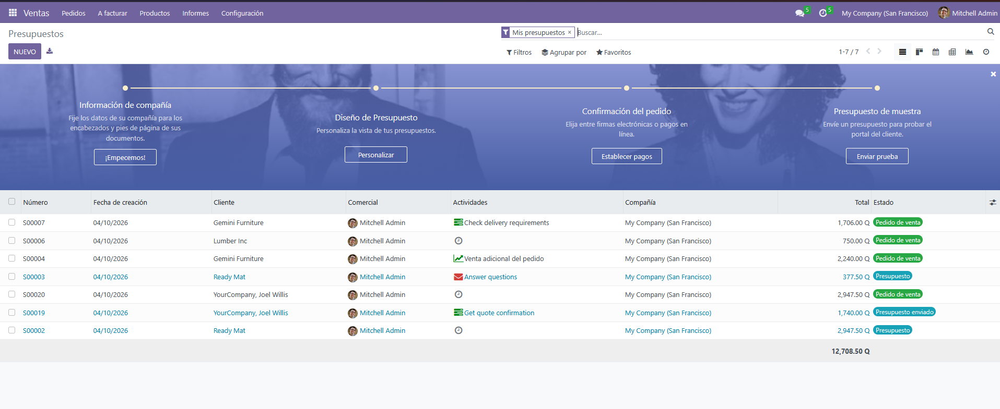  
*Figura 1: Vista general del tablero principal del módulo de Ventas con el listado de presupuestos.*

### 3.2 Verificación de Parámetros Comerciales y Facturación
Antes de emitir cotizaciones a clientes empresariales, el administrador debe comprobar las políticas de venta y facturación:
1. Diríjase a **Ventas -> Configuración -> Ajustes**.
2. En la sección **Presupuestos & pedidos**, verifique que estén habilitadas las opciones de firma o aprobación en línea y plantillas de presupuesto.

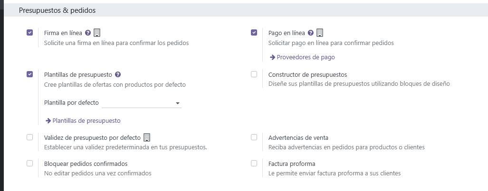  
*Figura 2: Opciones de configuración comercial activas en la sección Presupuestos & pedidos.*

3. En la sección **Facturas de cliente**, compruebe las opciones de entrega y facturación con direcciones de cliente diferenciadas para despachos empresariales.

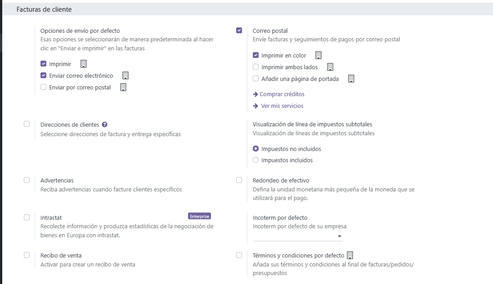  
*Figura 3: Parámetros de facturación de clientes y opciones de envío por defecto.*

### 3.3 Directorio de Clientes
Para comprobar la cartera de clientes disponibles:
1. Vaya a **Ventas -> Pedidos -> Clientes**.
2. Compruebe que la lista incluya clientes corporativos como **Hotel Casa Santo Domingo** y particulares como **María Fernanda Morales**.

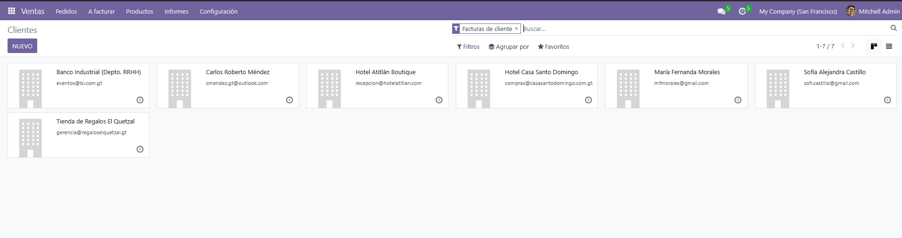  
*Figura 4: Directorio de clientes importados en la cartera comercial de Odoo.*

---

## 4. Ciclo 1: Cotización Corporativa y Conversión a Pedido de Venta

Este flujo explica cómo negociar y cerrar una venta por volumen con un cliente institucional que solicita artículos textiles para hotelería.

### 4.1 Creación del Presupuesto
1. Ingrese a **Ventas -> Pedidos -> Presupuestos** y presione el botón **Nuevo**.

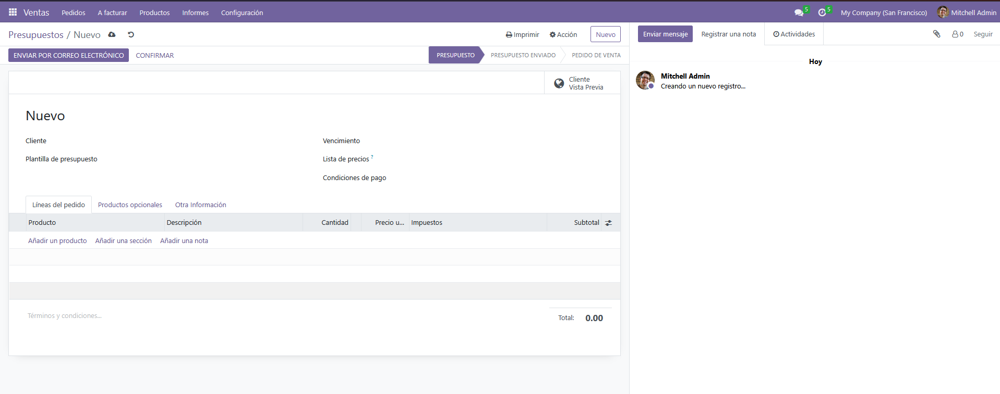  
*Figura 5: Formulario en blanco para la captura de una nueva cotización comercial.*

2. Llene los datos de la cabecera:
   * **Cliente:** Seleccione `Hotel Casa Santo Domingo`. Odoo autocompletará la dirección en Antigua Guatemala.
   * **Condiciones de pago:** Seleccione `15 días`.
   * **Vencimiento:** Asigne 30 días de vigencia a la cotización (ej. `05/11/2026`).

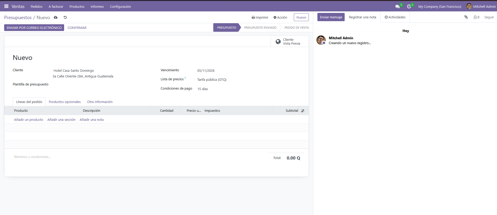  
*Figura 6: Cabecera con datos del cliente corporativo, condiciones de pago a 15 días y vencimiento.*

3. En la pestaña **Líneas del pedido**, presione **Añadir un producto** e incorpore los artículos solicitados:
   * `[RA-010] Cojín Decorativo Brocado 45x45cm`: 15 unidades a Q 220.00 (Total Q 3,300.00).
   * `[RA-011] Camino de Mesa Tejido Atitlán 2m`: 8 unidades a Q 340.00 (Total Q 2,720.00).
   * `[RA-014] Set de 6 Individuales Tejidos a Mano`: 10 unidades a Q 360.00 (Total Q 3,600.00).
   * Verifique que el importe total acumulado sea de **Q 9,620.00** (Base imponible Q 8,589.29 + IVA 12% Q 1,030.71).

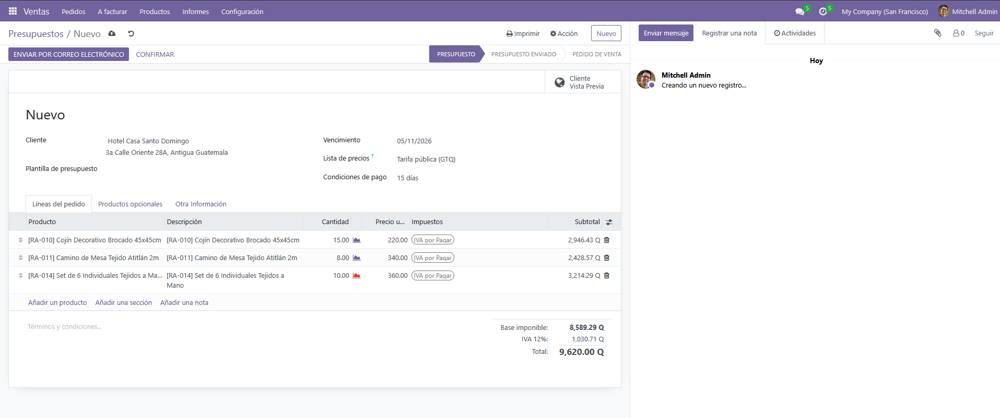  
*Figura 7: Detalle de productos textiles cotizados con cálculo de subtotales, IVA y total Q 9,620.00.*

4. Presione el botón de **Guardar** (o Confirmar). Se generará el número de pedido de venta oficial (correlativo `S00025`).

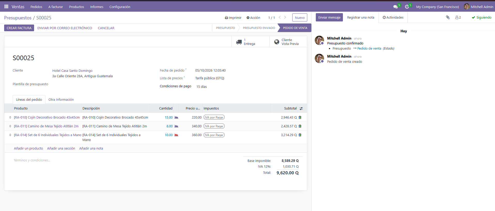  
*Figura 8: Cotización guardada y confirmada en el sistema con su correlativo oficial S00025.*

### 4.2 Emisión y Descarga del Documento Formal en PDF
1. En la barra superior del presupuesto, presione **Imprimir -> Presupuesto / Pedido**.
2. El sistema descargará un archivo PDF formal con la imagen corporativa de Raíz Artesanal, detallando el desglose de productos, cantidades, precios unitarios, condiciones de crédito y datos fiscales del cliente.

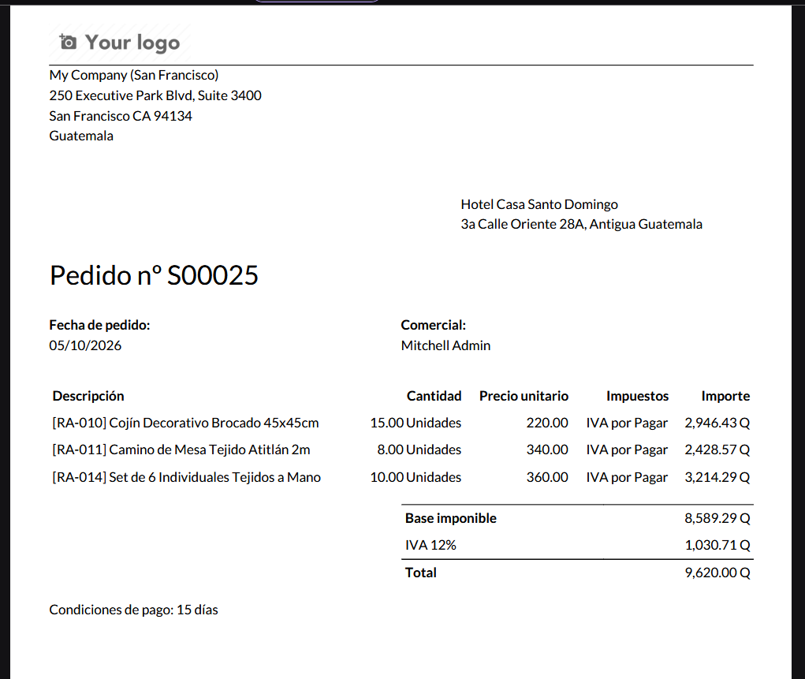  
*Figura 9: Vista del documento oficial de cotización en formato PDF para presentación al cliente.*

### 4.3 Confirmación de Venta y Reserva de Existencias en Almacén
1. Al confirmarse la venta, el estado del documento pasa a **Pedido de venta** y se habilita el botón inteligente superior **1 Entrega**.
2. Haga clic sobre el botón **Entrega** para ingresar a la orden de despacho (`WH/OUT/00014`).
3. Verifique que el almacén haya reservado las unidades físicas disponibles en estado **Listo**.

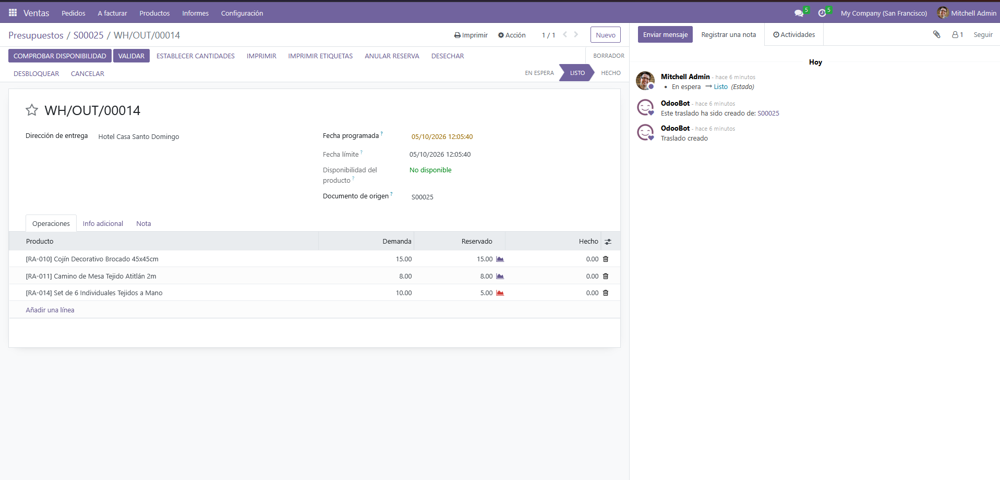  
*Figura 10: Orden de entrega generada (WH/OUT/00014) con existencias reservadas en el almacén en estado Listo.*

---

## 5. Ciclo 2: Venta Directa a Consumidor Individual y Facturación

Este flujo muestra la atención directa a una clienta particular que adquiere joyería artesanal de jade y plata con pago inmediato y despacho de almacén.

### 5.1 Registro de la Cotización Individual
1. En **Ventas -> Pedidos -> Presupuestos**, presione **Nuevo**.
2. Complete la información:
   * **Cliente:** `María Fernanda Morales`.
   * **Condiciones de pago:** `Pago inmediato`.
   * **Líneas del pedido:**
     * `[RA-022] Dije de Jade Verde en Plata 925`: 1 unidad a Q 490.00.
     * `[RA-023] Aretes de Jade Lila y Plata Artesanal`: 1 unidad a Q 430.00.
   * **Total a cobrar:** Q 920.00.

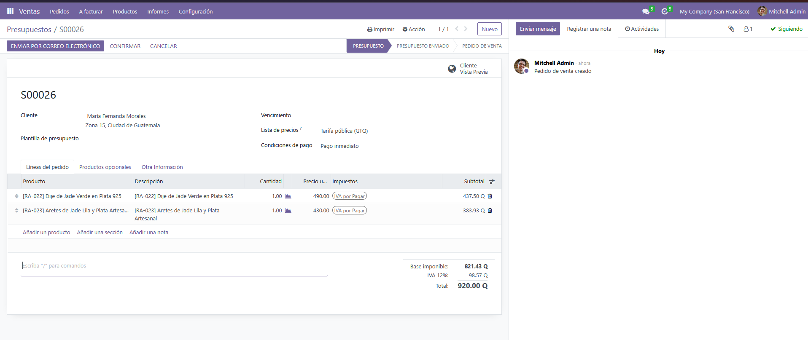  
*Figura 11: Formulario de cotización directa de piezas de joyería artesanal a María Fernanda Morales.*

### 5.2 Confirmación a Pedido de Venta
1. Presione el botón **Confirmar**.
2. El documento se convierte en Pedido de venta formal (`S00026`) y genera su orden de entrega inmediata.

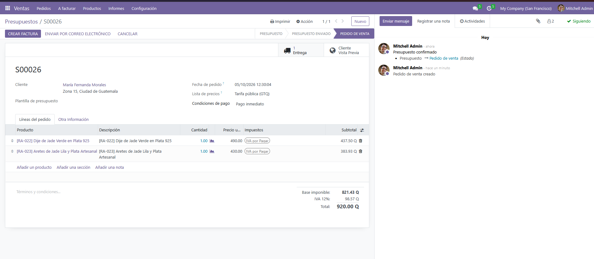  
*Figura 12: Pedido de venta S00026 confirmado con botón inteligente de entrega habilitado.*

### 5.3 Despacho y Salida Física de Bodega
1. Ingrese a la entrega mediante el botón inteligente **1 Entrega**.
2. Se muestra la orden de transferencia `WH/OUT/00015` en estado **Listo**.

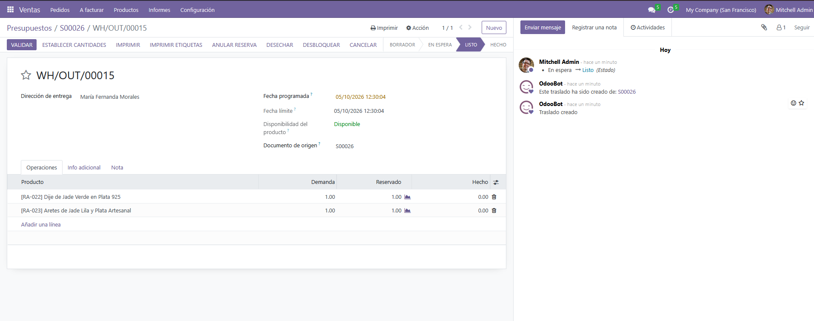  
*Figura 13: Orden de salida WH/OUT/00015 en estado Listo para validación de despacho.*

3. Presione el botón **Establecer cantidades** y posteriormente **Validar**.
4. Si aparece el cuadro de notificación por SMS, confirme la acción para proceder.
5. La orden pasa a estado **Hecho**, certificando la salida física de las piezas del almacén central.

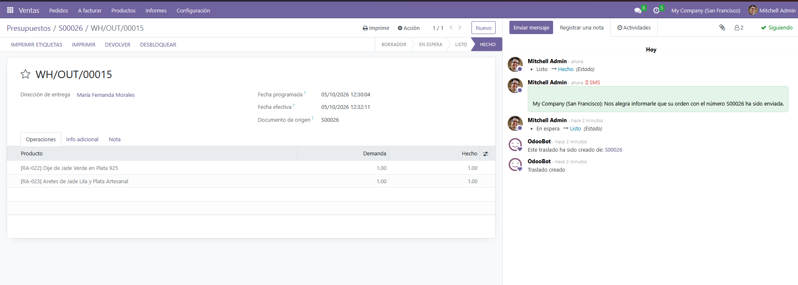  
*Figura 14: Traslado de almacén validado en estado Hecho con confirmación de entrega.*

### 5.4 Emisión de la Factura de Cliente
1. Regrese al pedido de venta `S00026` y presione el botón **Crear factura**.
2. Seleccione la opción **Factura regular** y presione **Crear y ver factura**.

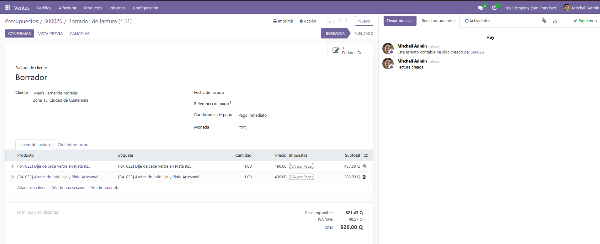  
*Figura 15: Cuadro de diálogo para generación de factura regular del pedido.*

3. En el borrador de factura generado, presione el botón **Confirmar**.
4. La factura adquiere numeración contable oficial (`INV/2026/00005`) y queda en estado **Publicado**, lista para registrar el cobro correspondiente.

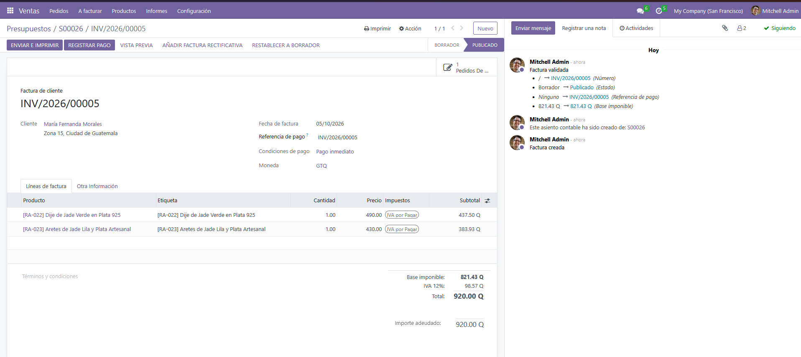  
*Figura 16: Factura de venta oficial confirmada en estado Publicado por valor de Q 920.00.*

---

## 6. Informes de Inventario y Control de Almacén

El ERP Odoo permite a los administradores y encargados de logística supervisar en tiempo real el estado de las existencias.

### 6.1 Reporte de Existencias Actuales y Valoración Monetaria
1. En el menú principal, ingrese a la aplicación **Inventario**.
2. Vaya a **Inventario -> Informes -> Stock** (o *Informe de inventario*).

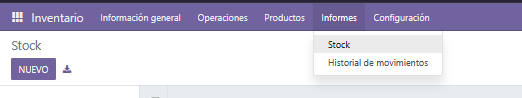  
*Figura 17: Acceso al reporte general de existencias desde el menú del módulo de Inventario.*

3. Se desplegará el catálogo completo de los 30 productos con sus cantidades a mano, pronósticos y valoración monetaria total en Quetzales (**Q 95,015.00**).

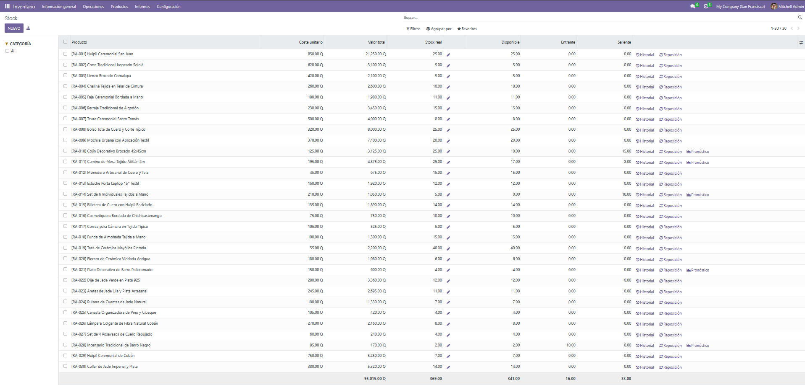  
*Figura 18: Listado general de existencias físicas de los 30 productos con valoración total de Q 95,015.00.*

4. En la barra de búsqueda superior, aplique la agrupación **Agrupar por -> Categoría de producto**. La tabla clasificará el inventario por las 6 familias artesanales (*Textiles y Ropa Tradicional*, *Accesorios y Cuero*, *Decoración y Hogar*, *Cerámica y Mayólica*, *Joyería de Jade y Plata*, *Fibras Naturales y Cestería*).

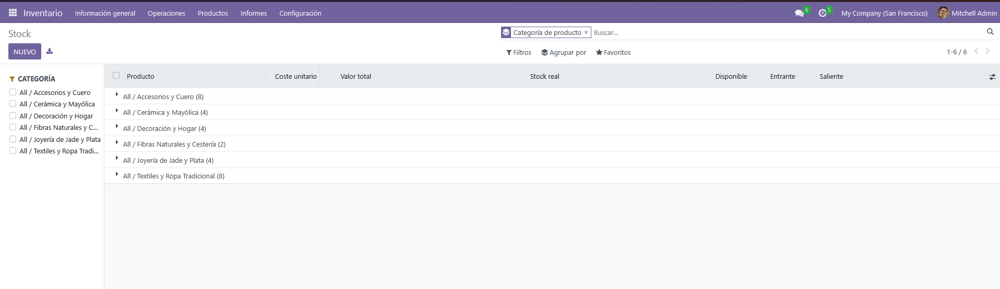  
*Figura 19: Existencias consolidadas y valorizadas agrupadas por las 6 categorías de producto artesanales.*

### 6.2 Reporte de Órdenes Pendientes de Proveedores
Para planificar la recepción de mercancía y supervisar los pedidos en tránsito:
1. Vaya a **Compra -> Pedidos -> Pedidos de compra**.
2. En la lista se observa la orden de compra **P00027** emitida al proveedor `Taller Cerámica Maya Antigua` por Q 1,750.00, con estado de facturación `Nada a facturar` y mercancía pendiente de recibir en almacén.

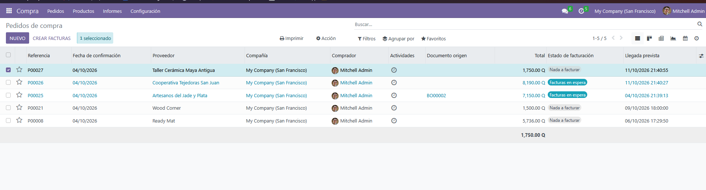  
*Figura 20: Reporte de compras con la orden P00027 pendiente de recepción en almacén.*

3. Para verificar la recepción pendiente desde la perspectiva de almacén, vaya a **Inventario -> Información general**, haga clic en **1 a procesar** dentro de la tarjeta **Recepciones** (o vaya a *Inventario -> Operaciones -> Traslados*).
4. Se observará la recepción **`WH/IN/00010`** vinculada a la orden `P00027` en estado **Listo**.

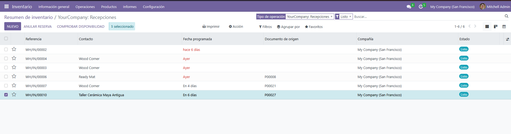  
*Figura 21: Vista de traslados de entrada pendientes (WH/IN/00010) en el módulo de Inventario.*

### 6.3 Reporte de Alertas de Stock Bajo y Reabastecimiento
1. Ingrese a **Inventario -> Operaciones -> Reposición** (o Reabastecimiento).
2. El sistema analiza automáticamente las existencias frente al stock mínimo de seguridad. El artículo `[RA-014] Set de 6 Individuales Tejidos a Mano` aparece alertado con pronóstico negativo de **`-5.00`** y sugerencia de compra inmediata.

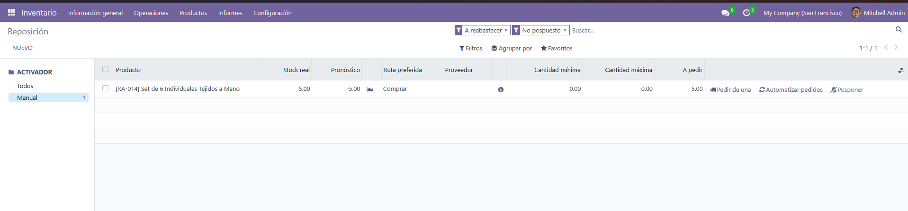  
*Figura 22: Tablero de reposición con alerta de stock de RA-014 Set de individuales.*

3. En la fila del artículo alertado, presione el botón **Pedir de una** (o *Pedir una vez*).
4. El sistema notifica la generación automática de la orden de reposición **`P00028`** en el módulo de Compras.

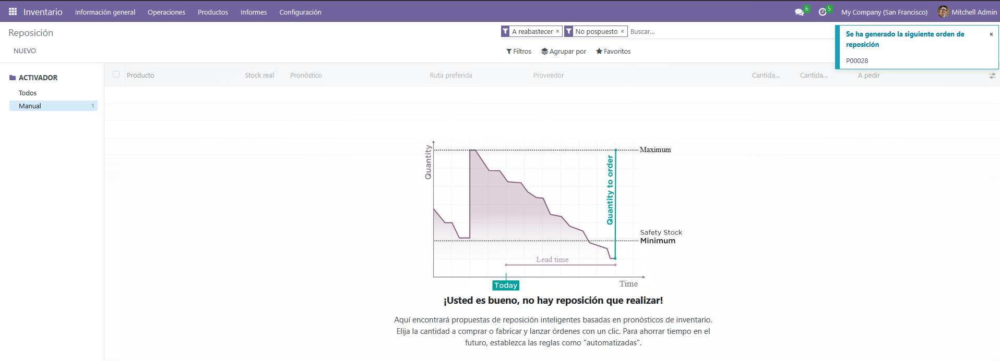  
*Figura 23: Generación automática de la orden de reposición P00028 tras presionar Pedir de una.*

---

## 7. Verificación de Movimientos y Salida de Stock

Para auditar la trazabilidad de las ventas realizadas:
1. Diríjase a **Inventario -> Informes -> Historial de movimientos**.
2. Filtre por los productos `RA-022` y `RA-023`.
3. Se aprecia la secuencia histórica completa de la cadena de suministro:
   * **Norma:** Ajuste inicial de inventario (+3 y +2 unidades).
   * **Javier:** Recepción de compra a proveedores `WH/IN/00008` (+10 y +10 unidades).
   * **Eduardo:** Despacho de venta `WH/OUT/00015` (-1 y -1 unidades transferidas a `Partners/Customers`).

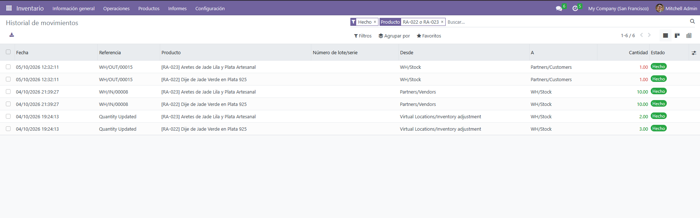  
*Figura 24: Historial de movimientos auditando la trazabilidad de entrada por compras y salida por ventas.*

---

## 8. Resumen de Buenas Prácticas para el Usuario

* **Validar existencias antes de cotizar entregas inmediatas:** Compruebe siempre que las cantidades estén en verde o que la producción bajo pedido cuente con el plazo pactado con el taller artesanal.
* **No despachar sin orden de entrega validada:** Cada salida de bodega debe tener su respectiva orden `WH/OUT` en estado Hecho para mantener la exactitud de inventario.
* **Revisar semanalmente el tablero de reposición:** Permite a la gerencia anticipar pedidos a las cooperativas antes de agotar por completo el catálogo en la tienda en línea.
